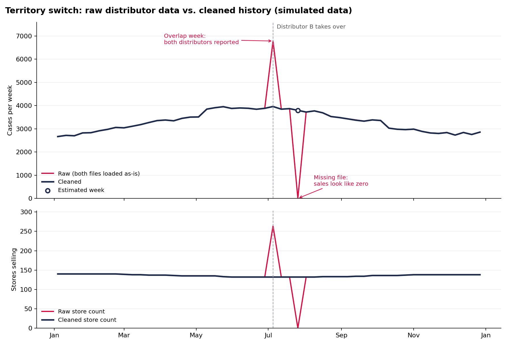

# Territory Transition Data Monitor

**Keeping sales history accurate when a beverage territory switches distributors.**



## The problem

Red Bull sells through two kinds of distributors in the US: its own company, Red Bull Distribution
Company (RBDC), and independent distributors (often beer wholesalers). Territories move between them.
Public trade news has covered Red Bull moving territories from independent wholesalers to RBDC, and
from one independent to another.

When that happens, the sales data for those stores suddenly comes from a different system. Store IDs
change, product codes change, and the first few weeks are messy. If nobody catches it, reports show
sales doubling one week and dropping to zero another, and store-level history breaks in half.

This project simulates one of those switches and builds a SQL pipeline that turns two messy distributor
feeds into one clean, continuous history, plus a list of every issue found and its business impact.

> **All data is made up.** Store names, IDs, addresses and sales are simulated. Product names follow Red
> Bull's public product lineup. This is a portfolio project and is not affiliated with Red Bull.

## The scenario

| | Distributor A (old) | Distributor B (new) |
|---|---|---|
| Who | Independent wholesaler | RBDC branch (simulated) |
| Reports | Jan 4 – Jul 5, 2025 | Jul 5 – Dec 27, 2025 |
| Dates | `07/05/2025` | `2025-07-05` |
| Store IDs | `C96050` | `RBDC-HOU-9110` |
| Addresses | `4482 NORTHWEST FWY` | `4482 Northwest Freeway` |
| Products | Its own item codes (`10120`) | Red Bull SKUs (`RB-1003`) |

Problems built into the data on purpose:

1. **Overlap week:** both distributors report the cutover week (double counting)
2. **Missing week:** Distributor B's file for one week never arrives
3. **Different store IDs:** most stores match on cleaned address, some only on name, and some not at all
4. **Missing product code:** a seasonal item (Summer Edition) was never added to the item crosswalk
5. **Messy SKU codes:** some come in lowercase or with extra spaces
6. **Duplicate rows:** some rows are sent twice
7. **Real store changes:** some stores closed before the switch and some opened after it, so not every unmatched store is an error

## Results

| | Raw data (loaded as-is) | After pipeline |
|---|---|---|
| Overlap week (Jul 5) | **+71%** too high | Correct |
| Missing week (Jul 26) | **Shows 0 sales** | Estimated within 2.3%, labeled "estimated" |
| Store matching | 0 stores linked | 125 of 132 linked automatically, **0 wrong links**, 7 sent for review |
| Unmapped product | Not visible | Flagged: 2,015 cases |

Every issue lands in one table (`dq_issues`) with severity, the number of cases affected, and what was done.

## How it works

```
data/raw/*.csv  ->  01 staging  ->  02 store matching  ->  03 product mapping
                ->  04 clean history  ->  05 quality checks  ->  06 dashboard tables
```

| Step | What it does |
|---|---|
| `01_staging.sql` | Fixes date formats, cleans SKU codes, removes duplicate rows, standardizes addresses (Road -> RD, Suite -> STE, ZIP+4 -> ZIP) |
| `02_store_matching.sql` | Rule 1: same cleaned address + ZIP. Rule 2: same store name + ZIP. Leftovers are labeled likely closed, likely new, or needs review |
| `03_product_mapping.sql` | Maps old item codes to Red Bull SKUs; keeps unmapped items in the totals but labels them |
| `04_clean_history.sql` | Uses A before cutover and B after; drops A's overlap rows; estimates the missing week from the weeks around it |
| `05_quality_checks.sql` | Writes every issue to `dq_issues` with severity and cases affected |
| `06_outputs.sql` | Weekly raw vs. clean comparison and the store match report |

## Run it

Needs only Python 3 (SQLite comes with it). For the chart: `pip install -r requirements.txt`.

```bash
python scripts/generate_data.py   # make the fake data
python scripts/run_pipeline.py    # run the SQL, export results, check accuracy
python scripts/make_chart.py      # optional: rebuild the chart
```

Results are saved to `data/output/` as CSVs, ready for Power BI.

The pipeline is checked against an answer key (`data/answer_key/`) that holds the true numbers.
The SQL never reads it; it's only used to measure how accurate the cleanup is.

## Other documents

- [`docs/requirements.md`](docs/requirements.md): the business request and how it became technical requirements
- [`docs/issue_log.md`](docs/issue_log.md): the issues found, written the way I'd send them to stakeholders
- [`docs/territory_transition_playbook.md`](docs/territory_transition_playbook.md): a week-by-week checklist for the next switch
- [`docs/powerbi_guide.md`](docs/powerbi_guide.md): how the dashboard is built

## What I'd do next with real data

- Add a third check against Red Bull's own shipments to each distributor (sell-in vs. sell-through)
- Use fuzzy matching (string similarity) for the stores left for review
- Run the checks automatically every week and alert when a file is late

## About

Built by **Muzammil (Muzi) Javed** · BBA in Management Information Systems, University of Houston (Bauer College of Busines)(http://linkedin.com/in/muzammil-javed/)
